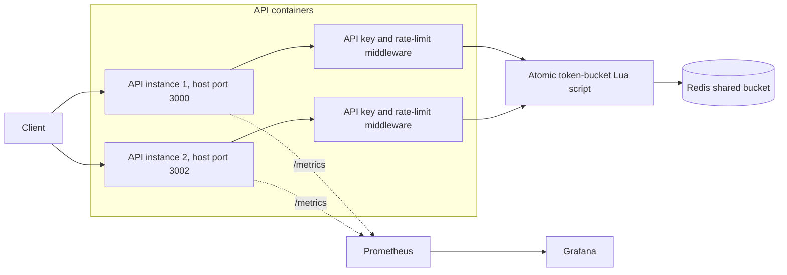
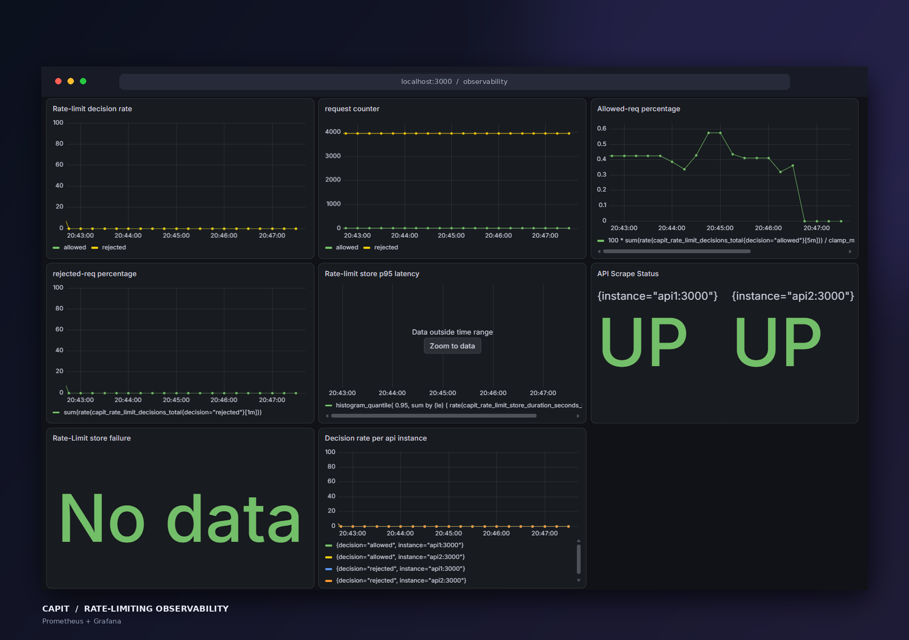
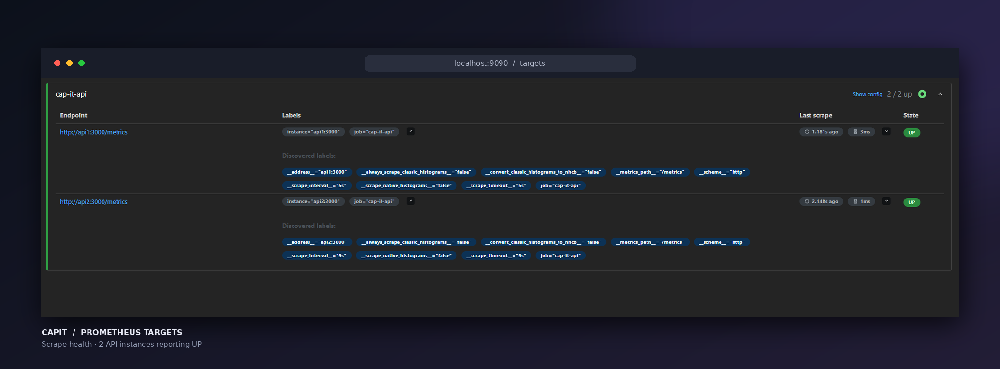

# Cap-It

Cap-It is a learning project for building a distributed rate limiter. It uses a token bucket backed by Redis, so multiple API instances can make rate-limit decisions against the same shared state.

The project also includes Prometheus metrics, a Grafana dashboard, and k6 load-test scripts. The goal is to understand how the pieces fit together, from a single request through a shared rate-limit decision to monitoring the result.

## How it works



Each API request passes through API-key authentication and rate-limit middleware. The middleware asks Redis to consume a token. Redis runs the Lua script atomically, which keeps concurrent requests and separate API instances consistent. Prometheus scrapes each API's `/metrics` endpoint, and Grafana queries Prometheus to display the metrics.

## Features

- Token-bucket rate limiting with a Redis-backed store.
- Atomic bucket updates using a Lua script.
- Multiple API instances sharing rate-limit state.
- API-key authentication and a request ID on each response.
- Fail-closed behavior if the rate-limit store is unavailable.
- Prometheus counters and a histogram for rate-limit decisions and store operations.
- Dashboard pages for overview, policy configuration, analytics, and API instance health.
- Grafana for exploring the collected metrics.
- Unit, integration, and k6 load-test examples.

## Run with Docker Compose

You need Docker Desktop with its engine running. From the project root, create a `.env` file containing a local API key:

```env
CAPIT_API_KEY=test-key
```

Then build and start the services:

```powershell
docker compose up --build -d
```

Compose starts Redis, two API containers, Prometheus, and Grafana. Check their status with:

```powershell
docker compose ps
```

The Redis container has a health check. Both API instances wait for Redis to become healthy before starting.

### Local URLs

| Service | URL |
| --- | --- |
| API instance 1 | `http://localhost:3000` |
| API instance 2 | `http://localhost:3002` |
| Prometheus | `http://localhost:9090` |
| Grafana | `http://localhost:3001` |

The APIs both listen on port `3000` inside their containers. Compose maps the second API to host port `3002` so both instances can be reached from your computer.

## Try the API

Check the health of each API instance:

```powershell
curl.exe http://localhost:3000/health
curl.exe http://localhost:3002/health
```

Call the rate-limited demo endpoint with the API key from `.env`:

```powershell
curl.exe -i -H "x-api-key: test-key" http://localhost:3000/demo
```

The demo policy has a bucket capacity of 3 tokens and refills at 1 token per second. Try alternating requests between ports `3000` and `3002`: the shared Redis bucket means both API instances use the same limit. An allowed request returns `200`; a request with no available token returns `429`.

The API also exposes Prometheus metrics at `/metrics`. You can inspect them directly at `http://localhost:3000/metrics` or in Prometheus. Prometheus is configured to scrape `api1:3000` and `api2:3000` over the Compose network. In Grafana, the Prometheus data source URL should be `http://prometheus:9090`.

The web dashboard reads structured data from `/dashboard/overview` and `/dashboard/analytics?range=5m`. Analytics supports `5m`, `15m`, `1h`, and `24h` ranges and requires the Prometheus service to be running. The API queries Prometheus and returns chart-ready data; the browser does not call the Prometheus query API directly.

### Metrics

| Metric | Type | What it measures |
| --- | --- | --- |
| `capit_rate_limit_decisions_total` | Counter | Allowed and rejected decisions, labeled by policy and outcome. |
| `capit_rate_limit_store_duration_seconds` | Histogram | Time spent on rate-limit store operations. |
| `capit_rate_limit_store_errors_total` | Counter | Rate-limit store operation failures, labeled by policy. |
| `capit_http_requests_total` | Counter | Application response counts grouped by method and status code; health, metrics, and dashboard endpoints are excluded. |
| `capit_http_request_duration_seconds` | Histogram | Application response latency grouped by method and status code; health, metrics, and dashboard endpoints are excluded. |

## Run the tests

Install dependencies from the repository root:

```powershell
npm ci
```

Run the test suite, type check, or linter:

```powershell
npm test
npm run typecheck
npm run lint
```

The Redis integration test expects Redis at `redis://localhost:6379` unless `REDIS_URL` is set. Start Redis before running that test. With the Compose stack running, the test process on your computer can use the published Redis port only if the Redis service publishes it; the current Compose setup keeps Redis internal to its Docker network. To run the integration test with this setup, start a local Redis instance on port `6379` or adjust the Compose Redis service to publish that port.

## Load testing with k6

Each script sends one request per iteration, then sleeps for one second. The request totals below are estimates based on that pacing; actual totals vary slightly with request latency and k6 scheduling.

| Script | VU profile | Duration | Approx. requests |
| --- | --- | --- | ---: |
| `baseline.js` | 2 steady VUs | 10 seconds | 20 |
| `burst.js` | 1 to 2 (2s), 2 to 10 (1s), hold 10 (5s), 10 to 0 (2s) | 10 seconds | 70 |
| `medium.js` | 50 steady VUs | 10 seconds | 500 |
| `heavy.js` | 100 steady VUs | 10 seconds | 1,000 |
| `extreme.js` | 500 steady VUs | 10 seconds | 5,000 |
| `stress.js` | 1 to 10 (10s), 10 to 20 (20s), 20 to 0 (10s) | 40 seconds | 450 |
| `extreme_distributed.js` | 0 to 100 (10s), 100 to 250 (10s), 250 to 500 (10s), hold 500 (10s), 500 to 0 (5s) | 45 seconds | 12,250 total, about 6,125 per API |

The Compose k6 service runs inside the same network as the APIs, so single-instance scripts target `api1:3000` and avoid the Windows host-port path. For example, run the 500-VU single-instance test with:

```powershell
docker compose --profile load run --rm k6 run /scripts/extreme.js
```

The other single-instance scripts use the same command pattern, replacing `extreme.js` with `baseline.js`, `burst.js`, `medium.js`, `heavy.js`, or `stress.js`. For the distributed 500-VU scenario, run:

```powershell
docker compose --profile load run --rm k6 run /scripts/extreme_distributed.js
```

This targets `api1:3000` and `api2:3000` directly, ramping through 100, 250, and 500 virtual users before holding at 500 briefly. The 500 VUs are split between the two APIs. The API health checks make Compose wait for both instances before starting the load test.

If you run k6 directly on your computer instead, pass the same key as `.env` and the script uses the published host ports:

```powershell
k6 run -e CAPIT_API_KEY=test-key tests/load/extreme_distributed.js
```

The load script accepts both `200` and `429` as expected responses. A transport failure such as a connection refusal means the request did not receive an HTTP response from the API.

In one 500-VU run from the host, 45 requests to `localhost:3002` were refused even though API 2 was healthy afterward. The exact cause was not established; the container stats did not show obvious CPU or memory pressure. Running k6 inside the Compose network bypasses the host-published ports. Comparing that run with a host-run test can help locate the failing network path, but does not by itself prove the cause.

## Useful Docker commands

```powershell
docker compose logs -f
docker compose restart api1 api2
docker compose down
```

`docker compose down` stops and removes the Compose containers and network. The named Prometheus and Grafana volumes keep their data for the next start.

## Screenshots

Add screenshots in the spaces below when you have them.

### Grafana dashboard




### Prometheus targets



## Project layout

```text
apps/api/                 Express API, routes, middleware, and metrics
packages/rate-limiter/    Token-bucket algorithm and in-memory/Redis stores
monitoring/               Prometheus scrape configuration
tests/unit/               Unit tests
tests/integration/        API and Redis integration tests
tests/load/               k6 load-test scenarios
Dockerfile                API container image
compose.yaml              Local Redis, API, Prometheus, and Grafana stack
```


